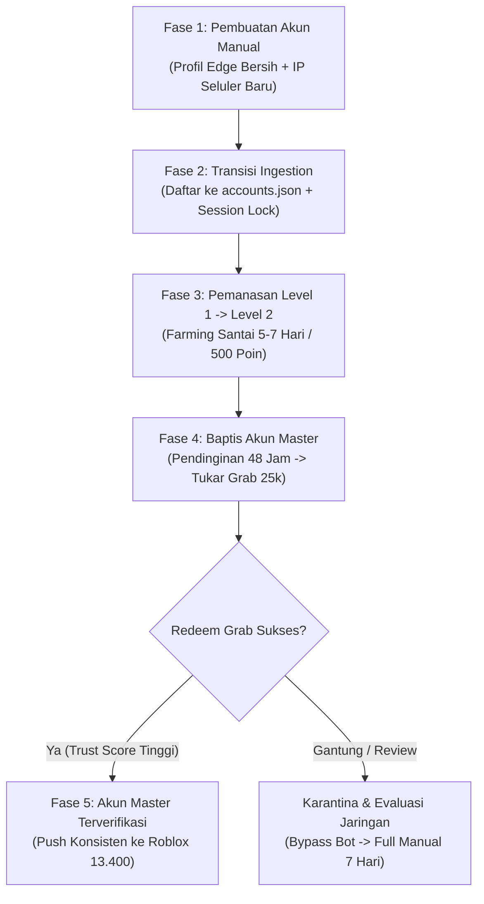
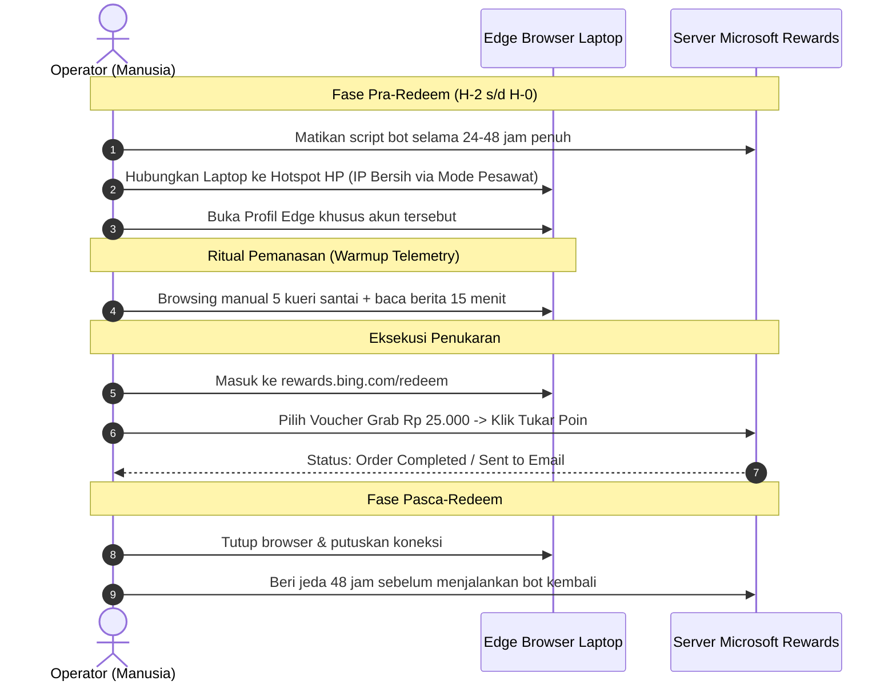

# STANDAR OPERASIONAL PROSEDUR (SOP) MULTI-ACCOUNT & MASTER ACCOUNT LIFECYCLE
## Microsoft Rewards Script Automation & Safe Farming Architecture

**Versi Dokumen:** 1.0.0  
**Target Arsitektur:** 15 Akun Master (Regional Indonesia / ID)  
**Infrastruktur Perangkat:** 2 Unit Laptop (Edge Browser Multi-Profile) & 2 Unit Smartphone (Android Isolated Environment)  
**Koneksi:** Jaringan Data Seluler Dinamis (Rotasi IP via Mode Pesawat)  

---

## DAFTAR ISI
1. [Arsitektur Keseluruhan Siklus Hidup Akun Master](#1-arsitektur-keseluruhan-siklus-hidup-akun-master)
2. [Matriks Distribusi Akun pada 4 Perangkat](#2-matriks-distribusi-akun-pada-4-perangkat)
3. [SOP Fase 1: Pembuatan Akun Baru Secara Aman (Account Creation)](#3-sop-fase-1-pembuatan-akun-baru-secara-aman-account-creation)
   - 3.1. Persiapan Lingkungan & Isolasi Perangkat
   - 3.2. Prosedur Jaringan (Rotasi IP Seluler)
   - 3.3. Langkah-Langkah Registrasi Akun Outlook
   - 3.4. Konfigurasi Profil & Registrasi Microsoft Rewards
4. [SOP Fase 2: Login Akun & Transisi ke Bot Ingestion](#4-sop-fase-2-login-akun--transisi-ke-bot-ingestion)
   - 4.1. Ekstraksi Kredensial & Session State
   - 4.2. Pendaftaran ke `accounts.json` dengan Isolasi Identitas
   - 4.3. Verifikasi Status Awal & Login Handshake
5. [SOP Fase 3: Pemanasan & Akselerasi ke Level 2 (Gold Medal)](#5-sop-fase-3-pemanasan--akselerasi-ke-level-2-gold-medal)
6. [SOP Fase 4: Validasi Akun Master (Uji Coba Redeem Grab 25k)](#6-sop-fase-4-validasi-akun-master-uji-coba-redeem-grab-25k)
7. [SOP Fase 5: Push Target Utama (Roblox 13.400) & Pemeliharaan Jangka Panjang](#7-sop-fase-5-push-target-utama-roblox-13400--pemeliharaan-jangka-panjang)
8. [Checklist Harian & Pantangan Keras (Do's and Don'ts)](#8-checklist-harian--pantangan-keras-dos-and-donts)

---

## 1. ARSITEKTUR KESELURUHAN SIKLUS HIDUP AKUN MASTER

Siklus hidup setiap akun dirancang secara ketat dalam 5 fase berurutan untuk menjamin bahwa akun memiliki skor kepercayaan (*Trust Score*) tinggi dan kebal terhadap deteksi penipuan (*fraud detection*) Microsoft.



---

## 2. MATRIKS DISTRIBUSI AKUN PADA 4 PERANGKAT

Untuk mengelola 15 akun pada 4 perangkat fisik tanpa memicu *Device Clustering*, gunakan pembagian kuota berikut:

| Perangkat Fisik | Metode Isolasi Lingkungan | Kuota Akun | Slot Akun | Peruntukan Utama |
| :--- | :--- | :---: | :---: | :--- |
| **Laptop 1** | Edge Browser Profiles terpisah | 4 Akun | Slot 01 – 04 | Farming Script Desktop + Manual Checkout |
| **Laptop 2** | Edge Browser Profiles terpisah | 4 Akun | Slot 05 – 08 | Farming Script Desktop + Manual Checkout |
| **Smartphone 1** | Ruang Kedua / Work Profile (Shelter) | 4 Akun | Slot 09 – 12 | Pemanasan Mobile + Read to Earn Manual |
| **Smartphone 2** | Ruang Kedua / User Profile AOSP | 3 Akun | Slot 13 – 15 | Pemanasan Mobile + Read to Earn Manual |

> [!IMPORTANT]
> **Aturan Isolasi Rumah Tangga (Household Limit):**
> Kebijakan resmi Microsoft membatasi maksimal **6 akun per alamat IP rumah tangga**. Jangan pernah menghubungkan lebih dari 4–5 akun pada 1 koneksi Wi-Fi yang sama dalam 24 jam. Gunakan selalu **Tethering Data Seluler** dengan rotasi mode pesawat.

---

## 3. SOP FASE 1: PEMBUATAN AKUN BARU SECARA AMAN (ACCOUNT CREATION)

Tujuan fase ini adalah melahirkan akun dengan reputasi bersih (*virgin profile*), terdaftar secara manual, dan memiliki telemetri manusia asli saat melewati captcha.

### 3.1. Persiapan Lingkungan & Isolasi Perangkat

#### Opsi Utama (Sangat Disarankan): Pembuatan via Laptop (Microsoft Edge)
1. Buka browser **Microsoft Edge** di Laptop.
2. Klik ikon foto profil di sudut kanan atas > Klik **Add Profile** (*Tambahkan Profil*).
3. Pilih **Continue without signing in** (*Lanjutkan tanpa masuk*).
4. Beri nama profil sesuai kode slot: misal `Master-08`, `Master-09`.
5. Buka `Settings` (`edge://settings/privacy`):
   * Aktifkan *Tracking Prevention* pada tingkat **Balanced**.
   * Jangan aktifkan VPN atau proxy apa pun di browser.

#### Opsi Cadangan: Pembuatan via Smartphone Android
1. **Dilarang keras memakai Dual Space / Clone Master.**
2. Buka **Ruang Kedua** (Xiaomi/HyperOS), **Secure Folder** (Samsung), atau **Shelter Work Profile**.
3. Gunakan browser resmi bawaan (Edge Mobile atau Chrome) yang ada di dalam ruang terisolasi tersebut.

---

### 3.2. Prosedur Jaringan (Rotasi IP Seluler Wajib)

Setiap 1 akun baru yang dibuat **wajib menggunakan 1 blok IP publik yang berbeda**.

```text
[LANGKAH ROTASI IP SELULER]
1. Matikan Wi-Fi di Laptop/HP.
2. Pada HP penyedia koneksi: Aktifkan "Mode Pesawat" (Airplane Mode) selama 7-10 detik.
3. Matikan "Mode Pesawat" dan biarkan data 4G/5G menyala kembali.
4. Hubungkan Laptop ke Hotspot HP tersebut.
5. Cek IP di browser (buka https://api.ipify.org atau https://whatismyipaddress.com).
6. Pastikan IP berubah sebelum membuka halaman registrasi Microsoft.
```

---

### 3.3. Langkah-Langkah Registrasi Akun Outlook

1. Di profil browser yang bersih, buka: **`https://signup.live.com`**.
2. **Pemilihan Email:**
   * Gunakan domain resmi `@outlook.com`.
   * Format nama email natural (mengandung nama dan tahun/angka wajar, contoh: `dimas.setiawan1998@outlook.com`, bukan susunan acak bot seperti `asdfghjk8972@outlook.com`).
3. **Kata Sandi (Password):**
   * Gunakan pola kata sandi kuat (kombinasi huruf besar, kecil, angka, simbol).
   * Catat segera di berkas pencatatan kredensial offline Anda.
4. **Data Profil (Sangat Penting):**
   * **Nama Depan & Nama Belakang:** Gunakan nama orang Indonesia yang wajar dan realistis.
   * **Negara/Wilayah:** Wajib pilih **Indonesia**.
   * **Tanggal Lahir:** Wajib setel usia **minimal 21 tahun** (hindari akun di bawah 18 tahun karena akan terkena limitasi Family Safety).
5. **Penyelesaian Captcha:**
   * Kerjakan puzzle verifikasi manusia secara manual dengan santai.
   * Jangan terburu-buru; jeda ketukan kursor/layar secara wajar membuktikan telemetri manusia.

---

### 3.4. Konfigurasi Profil & Registrasi Microsoft Rewards

1. Setelah masuk ke halaman beranda Outlook/Microsoft Account, buka tab baru ke: **`https://rewards.bing.com`**.
2. Klik tombol **Gabung Sekarang** (*Join Now*) atau **Mulai Menghasilkan** (*Start Earning*).
3. Begitu dashboard Rewards terbuka:
   * **Selesaikan Onboarding Quest pertama**: Biasanya ada survei mini selamat datang atau kartu promosi 5–10 poin.
   * Lakukan **1 atau 2 pencarian acak** di bilah pencarian Bing atas (misal mencari: *cuaca hari ini*, *jadwal bioskop*, *resep nasi goreng*).
4. Biarkan tab tetap terbuka selama minimal 2–3 menit (*dwell time*) agar cookie telemetry sesi tersimpan kokoh di server Microsoft.

---

## 4. SOP FASE 2: LOGIN AKUN & TRANSISI KE BOT INGESTION

Setelah akun dibuat secara manual, akun perlu didaftarkan ke sistem skrip otomatisasi tanpa memutus kontinuitas sesi (*session continuity*).

### 4.1. Ekstraksi Kredensial & Pendaftaran `accounts.json`

Setiap entri akun di berkas `accounts.json` wajib memiliki metadata isolasi unik untuk mencegah kebocoran antar akun.

Format standar penambahan akun baru ke `accounts.json`:

```json
{
    "email": "dimas.setiawan1998@outlook.com",
    "password": "PasswordKuatAnda123!",
    "geoLocale": "ID",
    "accountId": "generate-uuid-v4-disini",
    "participantId": "generate-uuid-v4-disini",
    "householdId": "household-cluster-01",
    "proxy": {
        "proxyAxios": false,
        "url": "",
        "port": 0,
        "username": "",
        "password": ""
    }
}
```

> [!TIP]
> **Petunjuk UUID:** Anda dapat membuat UUID v4 baru secara cepat menggunakan perintah terminal:
> `node -e "console.log(require('crypto').randomUUID())"`

---

### 4.2. Jalur Uji Pertama Kali (First-Run Verification)

1. Pastikan berkas konfigurasi utama `config.json` menggunakan mode sekuensial yang aman:
   ```json
   "executionMode": "sequential",
   "headless": true
   ```
2. Jalankan bot secara terarah hanya untuk akun baru tersebut:
   ```bash
   npm run start
   ```
3. Pantau log terminal:
   * Pastikan bot mendeteksi regional `[GEO-ADAPTIVE] Regional Indonesia (ID)`.
   * Pastikan saldo awal terbaca (misal 15–30 poin hasil onboarding manual).
   * Pastikan kuota pencarian Level 1 (30 PC) diselesaikan tanpa error `ACCOUNT-SUSPENDED`.

---

## 5. SOP FASE 3: PEMANASAN & AKSELERASI KE LEVEL 2 (GOLD MEDAL)

> **Durasi:** Hari ke-1 s.d. Hari ke-5  
> **Target Saldo:** 500 Poin (Mencapai Level 2 / Gold Medal)

1. **Jadwal Eksekusi Harian:**
   * Jalankan script **hanya 1 kali per 24 jam** per akun.
   * Waktu terbaik: Pagi hari antara pukul **07.30 – 11.00 WIB** (setelah reset server Microsoft Rewards pukul 07.00 WIB).
2. **Karakteristik Level 1:**
   * Kuota pencarian Level 1 sangat terbatas: PC Search maksimal 30 poin (10 kueri).
   * Jangan memaksakan mencari kuota tambahan.
   * Manfaatkan tugas harian katalog Indonesia: Daily Check-In, kartu "Keep earning", dan Read to Earn.
3. **Naik ke Level 2 (Gold):**
   * Di hari ke-4 atau ke-5, saldo akun akan menembus **500 poin**.
   * Begitu mencapai Level 2, kuota pencarian harian akun akan otomatis terbuka penuh menjadi **90 PC Search + 60 Mobile Search**.

---

## 6. SOP FASE 4: VALIDASI AKUN MASTER (UJI COBA REDEEM GRAB 25K)

> **Ambang Batas Syarat:** Akun telah berumur minimal 20–25 hari dan mencapai saldo **~5.000 Poin**.

Ini adalah fase paling kritis untuk "membaptis" akun biasa menjadi **Akun Master Terverifikasi**.



### Aturan Emas Fase 4:
1. **Dilarang Redeem via Bot:** Penukaran poin wajib dilakukan **100% manual oleh manusia melalui browser Edge di Laptop**.
2. **Wajib Jeda 24–48 Jam:** Hentikan script bot setidaknya 1 hari sebelum penukaran poin.
3. **Ritual Browsing 15 Menit:** Sebelum menekan tombol redeem, lakukan scrolling dan pencarian berita lokal di Bing secara alami.
4. **Target Voucher Pertama:** Pilih selalu **Voucher Grab Rp 25.000** atau **Alfamart/Indomaret Rp 25.000**. Jangan langsung menukar nominal besar pada order perdana.

---

## 7. SOP FASE 5: PUSH TARGET UTAMA (ROBLOX 13.400) & PEMELIHARAAN

Setelah sebuah akun berhasil mencairkan voucher Grab 25k pertamanya, akun tersebut telah berstatus **Akun Master**.

1. **Jalur Push Menuju 13.400 Poin:**
   * Di Level 2, akun mengumpulkan rata-rata **200 poin/hari**.
   * Dari 5.000 ke 13.400 butuh tambahan 8.400 poin (~42 hari eksekusi stabil).
2. **Interval Penukaran Lanjutan:**
   * Setelah sukses redeem Grab ke-1, Anda boleh mengulang redeem Grab ke-2 jika ingin menambah bukti reputasi akun.
   * **Beri jeda minimal 3–5 hari** antara penukaran pertama dan kedua. Jangan pernah redeem 2 hari berturut-turut pada akun yang sama.
3. **Pencairan Kode Roblox (13.400):**
   * Begitu menyentuh 13.400 poin, gunakan prosedur yang sama persis dengan Fase 4 (Jeda script 48 jam -> Browsing manual di laptop -> Checkout Roblox Gift Card).
   * Kode digital Roblox akan dikirimkan langsung ke inbox email Outlook akun tersebut secara instan.

---

## 8. CHECKLIST HARIAN & PANTANGAN KERAS (DO'S AND DON'TS)

### ✅ APA YANG WAJIB DILAKUKAN (DO'S):
- [ ] Selalu lakukan **Mode Pesawat 10 detik** pada modem/HP sebelum menjalankan bot untuk akun berikutnya jika menggunakan koneksi seluler.
- [ ] Jalankan akun dengan mode `sequential` (satu per satu secara berurutan, bukan paralel bersamaan).
- [ ] Selalu periksa kesehatan akun secara berkala melalui web dashboard lokal di `http://localhost:4000`.
- [ ] Catat email, password, tanggal pembuatan, status level, dan riwayat redeem dalam spreadsheet offline yang terorganisasi.
- [ ] Berikan hari libur acak (*random rest day*): biarkan akun tidak dijalankan 1 hari setiap minggu agar pola tidak seperti mesin terjadwal kaku.

### ❌ APA YANG DILARANG KERAS (DON'TS):
- [ ] **DILARANG** menggunakan aplikasi *cloner* (Dual Space, Clone Master, Parallel Space) di smartphone Android.
- [ ] **DILARANG** menghubungkan lebih dari 5 akun secara bersamaan ke 1 router Wi-Fi rumah tanpa rotasi IP.
- [ ] **DILARANG** menggunakan VPN (gratis/berbayar) atau Datacenter Proxy murah saat proses checkout redeem.
- [ ] **DILARANG** melakukan penukaran poin (*redeem*) secara beruntun dalam selang waktu kurang dari 48 jam pada akun yang sama.
- [ ] **DILARANG** langsung menekan tombol redeem sesaat setelah script bot selesai mengumpulkan poin (wajib pendinginan 24–48 jam).
